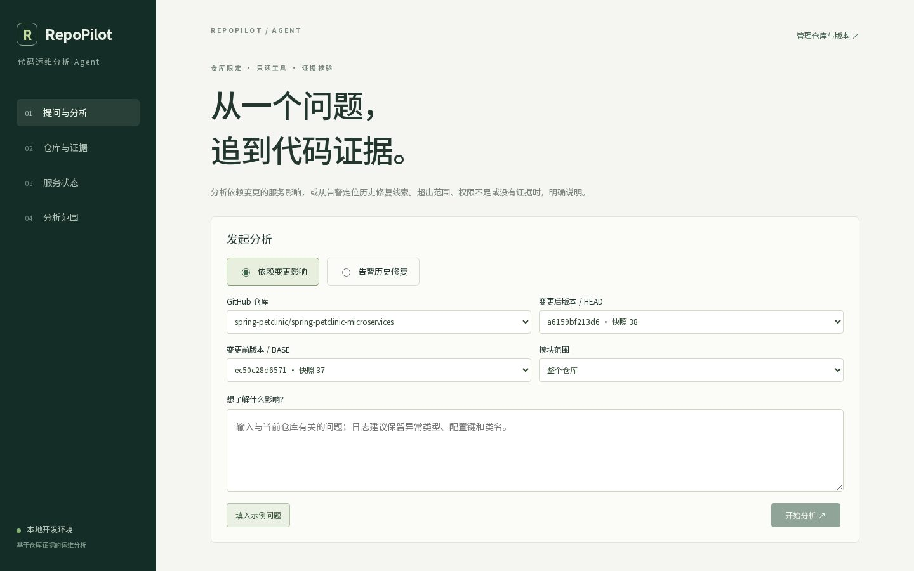
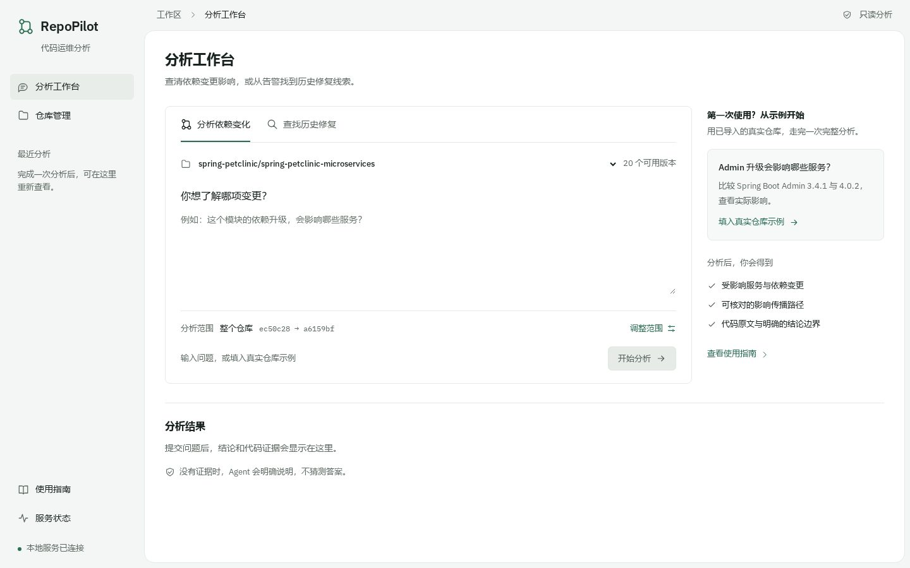
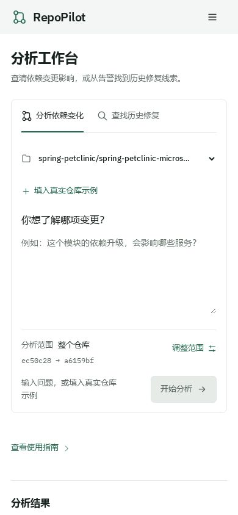

# 前端重构记录

## 问题与改动

原页面把仓库、快照、版本比较、模块、提问、工具事件和原文证据同时铺开。用户不知道从哪里开始，也难以区分结论和技术细节。本次保留真实 API 与业务能力，围绕第一次完成分析重新安排界面。

| 原来 | 现在 |
| --- | --- |
| 大幅宣传标题占据首屏，主任务靠下 | 22px 应用标题，首页直接提供两种任务和问题输入 |
| 需要自己寻找版本、模块，再填一个泛化示例问题 | 真实仓库示例同时填好问题、提交和模块；用户确认后再开始分析 |
| HEAD、BASE、快照 ID 与多个下拉框常显 | 简短范围摘要；“调整范围”展开版本和模块；版本带真实提交说明 |
| 工具过程、长 SHA 和大量标记抢占阅读顺序 | 先显示服务影响或修复线索，技术记录按需展开 |
| 证据按钮堆叠、代码直接撑开结果 | 独立原文侧栏，支持选择证据、复制 SHA、GitHub 原文和 Escape 关闭 |
| 仓库同步、检索、直接比较挤在同一页面 | 仓库管理分为版本、代码检索和手动比较三个视图 |
| 手机导航多行占据页面 | 菜单收起；示例快捷入口放在提问区内；主要按钮至少 44px |

最近分析只在浏览器中保存任务 ID 和任务类型，既能重新打开结果，也避免把输入日志存入本机历史。网络错误与空仓库分别处理；拒答用中文解释原因和下一步，完整错误码保留在技术详情中。

## 如何使用

1. 打开首页，选择“分析依赖变化”或“查找历史修复”。
2. 第一次使用可点击“填入真实仓库示例”，检查填入的问题与范围，再点击“开始分析”。没有导入示例版本时，到仓库管理的示例版本说明中填入并导入对应提交。
3. 阅读服务影响或修复线索，点击“查看原文证据”核对来源。需要改版本或模块时展开“调整范围”；执行记录与覆盖限制不必在首次操作前理解。

## 技能与设计依据

实际使用 [taste-skill](https://github.com/Leonxlnx/taste-skill) 的应用界面路线，以及 [impeccable](https://github.com/pbakaus/impeccable) 的 distill、onboard 和 craft-floor。仓库地址纠正、版本和加载器修复见[设计工具](设计工具.md)。

选择 Framed sheet，seed `1530780598`，未重抽。界面的首要问题是“怎样对所选仓库完成一次分析”；结果区域回答“影响哪些服务 / 哪些历史提交值得核对”。品牌特征来自 Git 分支及可追溯路径，IBM Plex 字体自托管；没有加入装饰图片、虚构统计或新的 UI 框架。

## 前后对比

桌面旧页面：



桌面新版：



手机版：



另存有平板对比图与[机器可读检查记录](ui/review.json)。截图来自真实本机 API；其中的仓库版本数量是检查时的数据，不是产品承诺或固定演示数字。

## 实际验证

- Vue 类型检查与生产构建通过；原有 Vue 3、Pinia、Vue Router 和后端接口保持兼容。
- 真实 Chromium 在生产预览上跑通依赖影响、Zipkin 历史候选、证据侧栏与复制、Escape 关闭、刷新恢复、最近任务切换、取消分析和范围调整。
- 仓库版本列表、代码检索、直接依赖比较、指南中的示例跳转和手机菜单均实际操作验证。
- 无证据、范围外、未授权请求均明确说明；额外模拟空仓库与网络失败，验证不会把网络错误描述成“没有仓库”。
- taste-skill 对首页的 1440 / 768 / 390px 生产截图检查最终为 **0 FAIL / 0 WARN**。旧页面在同一套目标风格规则下为 2 FAIL / 4 WARN，包含未加载目标字体、字号过小、对比度和大标题问题；这个计数不能直接等同于用户满意度。
- impeccable 官方引擎 0.1.18 的上下文命令恢复，主要改动的机械扫描输出为 `[]`。扫描后又将手机示例入口提前，最终生产截图与浏览器验证覆盖此调整。

真实接口回归命令：

```bash
npm --prefix frontend run build
# 后端已使用 scripts/dev.py agent 启动；前端预览可以是 5173 或生产预览 5174。
PLAYWRIGHT_MODULE=/tmp/repopilot-browser/node_modules/playwright \
PLAYWRIGHT_BROWSERS_PATH=/tmp/repopilot-browser-binaries \
REPOPILOT_PREVIEW_URL=http://127.0.0.1:5174 node scripts/preview-smoke.cjs
```

Playwright 仅用于开发验证，不加入产品运行依赖。需要先准备真实仓库样本和模型，详见 [D5～D8 验证](verification/D5-D8验收.md)。本次不改后端，也不把前端烟测当作 18%→4% 工具失败率基准。
